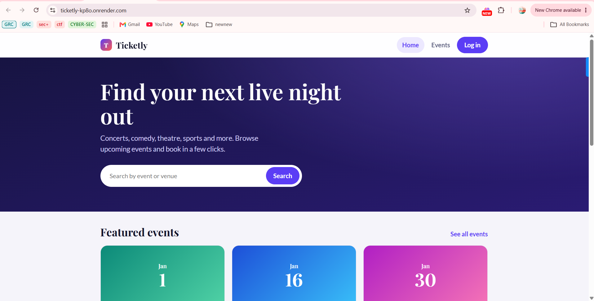
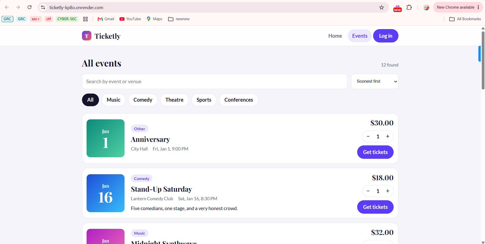
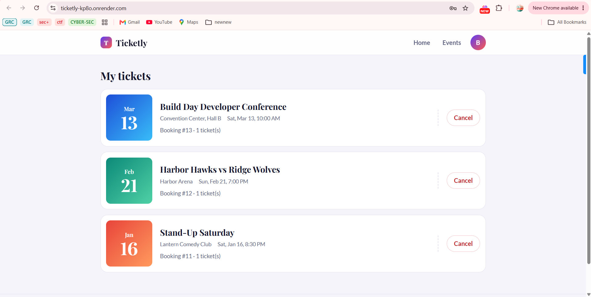
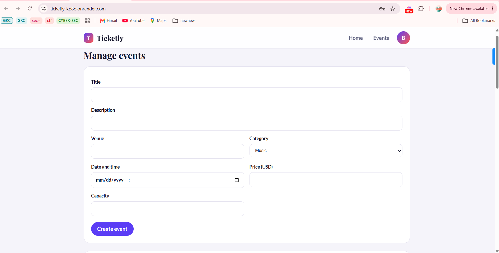

# Ticketly

A full-stack event ticketing app, built with a security-first approach: browse events by category, book tickets, manage your bookings, and manage events as an admin.

**Live demo:** https://ticketly-kp8o.onrender.com/

> The demo runs on free hosting, so the first load after a quiet period can take up to a minute while the server wakes up. Register your own account to try it. There are no real payments.



| Events | My tickets | Admin | Login |
| --- | --- | --- |
|  |  |  |(docs/screenshots/login-signup.png) |

## Features

- Home page with featured events, category tiles and a search box
- Events page with search, category filters and sorting by date or price
- Registration and login with role-based access (user and admin)
- Ticket booking with a live total, plus a "My tickets" page where you can cancel your own bookings
- Admin panel to create and delete events
- Responsive layout that works on phones

## Tech stack

| Layer | Technology |
| --- | --- |
| Frontend | React, Vite |
| Backend | Node.js, Express |
| Database | PostgreSQL (Neon) |
| Hosting | Render (web service and static site) |
| Security libraries | bcrypt, jsonwebtoken, helmet, zod, express-rate-limit, winston |

```
Browser (React)  -->  Express API (Render)  -->  PostgreSQL (Neon)
```

## Security controls

| Area | What I implemented |
| --- | --- |
| Passwords | Hashed with bcrypt (cost 12); minimum length of 10 characters |
| Authentication | Signed JWTs (HS256) that expire after 1 hour; the accepted algorithm is pinned on verification |
| Authorization | Role checks on the server for every admin route; the client is never trusted |
| Object-level access | Bookings are always filtered by the logged-in user's ID, so one user can't cancel another user's booking |
| Injection | Every query is parameterized; request bodies are validated with zod |
| Brute force | Rate limit of 10 attempts per 15 minutes on login and registration |
| Account enumeration | Login returns the same error whether the email exists or not |
| Transport and headers | HTTPS on the hosted app; security headers via helmet; CORS limited to the frontend's origin |
| Request size | JSON bodies are capped at 10 KB |
| Data integrity | Database constraints (roles, quantities, capacity); bookings use a transaction with a row lock so the last ticket can't be sold twice |
| Logging | Structured JSON logs for registrations, logins (successes and failures), bookings and admin actions, ready to be ingested by a SIEM |
| Secrets | Kept in environment variables, never committed |

## API

| Method | Endpoint | Access |
| --- | --- | --- |
| GET | `/api/health` | Public |
| POST | `/api/auth/register` | Public, rate limited |
| POST | `/api/auth/login` | Public, rate limited |
| GET | `/api/events` | Public |
| POST | `/api/events` | Admin |
| DELETE | `/api/events/:id` | Admin |
| POST | `/api/bookings` | Logged in |
| GET | `/api/bookings` | Logged in (own bookings only) |
| DELETE | `/api/bookings/:id` | Logged in (own bookings only) |

## Run it locally

Requirements: Node.js 18 or newer and a PostgreSQL database (a free Neon project works).

```bash
git clone https://github.com/NayaAlibrahim/ticket-app.git
cd ticket-app
```

**1. Database:** run `server/src/db/schema.sql` against your database.

**2. Backend:**

```bash
cd server
npm install
```

Create `server/.env`:

```
PORT=4000
CLIENT_URL=http://localhost:5173
DATABASE_URL=your-postgres-connection-string
JWT_SECRET=a-long-random-string
```

```bash
npm run dev
```

**3. Frontend** (in a second terminal):

```bash
cd client
npm install
npm run dev
```

Open http://localhost:5173. To create an admin, register an account and then run:

```sql
UPDATE users SET role = 'admin' WHERE email = 'you@example.com';
```

The frontend reads the API address from `VITE_API_URL` and defaults to `http://localhost:4000/api`.

## Project structure

```
ticket-app/
  client/                 React app (Vite)
  server/
    src/
      routes/             auth, events, bookings
      middleware/         authentication and role checks
      db/                 connection pool and schema.sql
      utils/              logger
```

## Security testing and roadmap

This app is the target for the rest of my security portfolio:

- [ ] **Penetration test** and written report (OWASP Top 10), with fixes and a retest
- [ ] **Monitoring:** a SIEM lab that ingests this app's logs and detects the attacks from the pentest
- [ ] **Risk assessment** against ISO 27001 / NIST CSF

## Author

Built by Naya Alibrahim.
